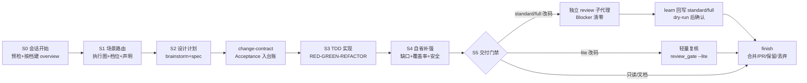

# conductor · AI 开发工作流主控 Skill

> 一个让 AI 按**统一工程流程**干活的 skill：从需求、设计、TDD、审查到收尾交接，
> 由一个"指挥家"贯穿始终。适用于 Claude Code、Codex、OpenCode、Droid、WorkBuddy 等支持 `SKILL.md` 的 agent。

---

## 这是什么

`conductor` 是本仓库的核心 skill，定位是**唯一的流程主控**。它把原本散落、靠 AI 自觉的开发步骤，
固化成一条强制按顺序走的工程链，并配合一组专业工具 skill 各司其职。

它解决几个真实痛点：

- **流程漂移**：AI 收到"开发/重构/修 bug"就上手写码，跳过设计和测试 → conductor 强制"规格未确认不动手、无失败测试不算实现"。
- **运动员当裁判**：执行者自查总说"通过"，用户另叫一次审查却查出大问题 → 改码场景交付前必经**独立 review 门禁**（全新上下文子代理）。
- **裸跑冒充达标**：手跑 `pytest -q` 全绿就宣称覆盖率达标 → 测试证据**只认 `verify.py`** 输出，内置覆盖率门禁。
- **文档-代码脱节、改这里漏那里** → 接线四问、缺口台账、样例补全、影响面分析。
- **上下文膨胀**：overview 和参考文档越积越多 → L0/L1/L2 分层加载 + 按节加载，省 token。

## 核心特性

| 特性 | 说明 |
|---|---|
| **唯一主控** | 工程纪律已内化，不再有"治理外壳 + 外部工程内核"两套工作流；外部 skill 只是被调用的工具 |
| **14 场景 + 5 路径** | 初始化/架构/设计/开发/迭代/重构/解 bug/拷问/理解/文档同步/门禁/测试补课/文档清理等；路径=改码/只读/文档/文档·清理变体/验证，决定跳过哪些阶段 |
| **S0–S5 阶段机** | 会话开始 → 场景路由（同时判成本档位）→ 设计计划 → TDD 实现 → 自省补强 → review 收尾 |
| **机体—器官—环境架构** | conductor 只做状态机/门禁/决策；10 个 `skills/conductor-*` 是单一能力器官（路由/头脑风暴/活规格/TDD/review/学习回写/台账/overview/影响面/调试），14 场景是工作环境；入口 SKILL.md 约 3.0k 字符 |
| **成本档位 lite/standard/full** | 小改动只跑必要步骤（省掉 overview L1 交接/env_probe/台账/影响面/活规格/学习回写/独立子代理），高风险仍跑全套；判档与"省掉"写进路由声明可纠正 |
| **结构化路由** | 不靠关键词匹配，用"语义三问 + 有限结构算子"把一句话解析成执行图，带置信度、假设明示、可纠正 |
| **五道锁 + 铁律** | 写码前/中/后、提交前、交付前独立 review，把"建议"变"门禁" |
| **确定性脚本** | 16 个工作流入口 + 4 个测试/审计脚本；其中 6 个重复入口是薄 shim，实现唯一真相源在器官目录，`script_parity_test.py` 防漂移 |
| **真实环境纪律** | 无 Docker/DB 时**不砍功能**：生产实现照写，只在真实环境能验证的部分标「待验证」；用户要真实测试时跑真实入口（如 `tests/integration/`），不复用 mock 命令 |
| **会话记录** | **一个会话一个 overview**，由会话指针 `.conductor-session.json` 锚定（同会话多轮归同一文件，跨 agent 通用、零环境变量依赖；换任务 `--new-session`），按"记什么/不记什么"过滤，问题带状态；分层加载（L0 索引卡 / L1 摘要 / L2 详情引用） |

## 工作流程



> 路径不同会裁剪阶段：只读场景（拷问/理解）到 S4 分析变体后结束，不跑 TDD 与 verify。

## 目录结构

```
skills/
├── conductor/                  ← 核心主控 skill
│   ├── SKILL.md                ← AI 加载入口（触发元数据 + 门禁 + 阶段矩阵）
│   ├── references/             ← 8 份机体级文档（方法已拆到器官）
│   │   ├── 01-routing/         ← 器官总线、路由、成本档位、场景、overview 规范、skill 矩阵
│   │   ├── 02-engineering/     ← 工程纪律（内化自 superpowers）
│   │   ├── 04-guards/          ← 机体门禁（源码纯净/提交/发布）
│   │   └── 05-meta/            ← 索引 + 路线图
│   └── scripts/                ← 16 个工作流入口（6 个薄 shim）+ 4 个测试/审计脚本
├── conductor-router / -brainstorm / -spec / -tdd / -review / -learn / -ledger / -overview / -impact / -debug
│                               ← 11 个器官 skill（与 conductor 同级目录；编码规则在 conductor-tdd/references）
├── (原协作 skill)              ← 全部 10 个原目录已删除：3 个方法并入器官，7 个判定废弃
└── ...
```

---

## 安装

### 方式一：整包克隆（推荐）

```bash
git clone https://github.com/sao-lang/skills.git
```

克隆后，把 `skills/` 下的各个 skill 目录放到你所用 agent 的 skill 目录（见下表"跨 agent 目录约定"）。

### 方式二：skills CLI 按需安装单个 skill

```bash
npx skills add sao-lang/skills --skill conductor
```

### 方式三：手动拷贝

把本仓库 `skills/conductor/` 整个目录复制到目标 skill 目录即可，无需编译。

### 跨 agent 目录约定

| Agent | 放置路径 |
|---|---|
| Claude Code | `.claude/skills/conductor/` |
| Codex | `.codex/skills/conductor/` |
| OpenCode | `.opencode/skill/conductor/` 或 `.config/opencode/skill/` |
| 通用 / WorkBuddy | `.agents/skills/conductor/` 或用户级 `~/.workbuddy/skills/conductor/` |

> conductor 不依赖任何 agent 的内置工具名；"加载 skill / 读文件 / 跑命令"等动作在各 agent 中等价表达。

### 验证安装

项目内运行预检，确认协作 skill 与语言验证工具是否就位：

```bash
python skills/conductor/scripts/preflight.py --project-root .
```

缺失项会给出安装命令。注意：**工程纪律已内置**，缺某个外部工具只影响该工具，不影响流程本身。

## 使用方法

不需要记命令——**用自然语言说需求即可触发**。conductor 会先做路由声明，你确认后它才推进。

典型说法：

- "帮我做一个用户注册功能" → 项目开发
- "这个模块怎么跑的，理一下调用关系" → 代码库理解（只读）
- "review 一下 M4 的设计有没有坑" → 拷问设计（只读）
- "把这个模块迁到新架构，别漏东西" → 项目重构（迁移台账：盘点→基线→逐块迁移→收口门禁）
- "怎么保证不漏需求/调用方/回归" → 承诺台账横切防线（S0 采集承诺→S4 核证据→S5 零未勾销才放行）
- "没连数据库就写了内存版实现" / "别用 Any" → 源码纯净门禁（规则库扫多语言多形状类型；重构用存量基线只管改到的文件）
- "占位没写依赖谁" / "这参数声明了没用，干嘛的" → 意图空白扫描（无注释占位/未用参数，AST 判定，合法场景写注释即可）
- "修掉这个报错" → 解 bug（先造最小复现）
- "把文档和代码签名对齐" → 文档/注释同步
- "先检查设计，再按设计写代码" → 场景链（拷问设计 → 设计闸门 → 设计驱动重构）
- "删除 M6 文档，根据 M6 文档先改代码" → 按时序推导重排（**按依赖执行，不按说话顺序**）：通读 M6（只读）→ 按 M6 改码 → 验证通过 → 最后才删 M6。删除被排到最后，因为改代码要读它。

> 场景链的时序由**依赖关系**决定：谁产出、谁消费、哪个资源会被销毁。删除依赖资源的操作一律排到最后，并在路由声明里显式说明为何重排。

路由声明长这样，你可以随时一句话纠正：

```
我判断本轮走【场景 5：项目迭代】，路径【改码】，置信度【0.9】。
依据（语义）：产出物=调整后代码，对象=具体功能，结构算子=无。
将走阶段：S0→S1→S2→S3→S4→S5；加载器官：brainstorm → spec → tdd → ledger → review → learn...
如判断有误，直接说"这是场景 X"，我立即重路由。
```

### 建议的工作习惯

1. **看路由声明再放行**：置信度中等时它会请你确认，认真看一眼场景和路径对不对。
2. **重视 L0 索引卡**：续接任务时它会先读 overview 的 L0（≤12 行），你也可以从这里快速了解进度。
3. **别跳过独立 review**：改码任务交付前的独立审查是硬门禁，不要在它报 Blocker 时强行推进。
4. **证据说话**：它给出的"测试通过"应带命令和退出码/覆盖率数字；没有证据的结论可以打回。

---

## 器官（原协作 skill 已并入或废弃）

conductor 是唯一主控；下列 11 个器官各负责一种能力，方法与脚本已自包含，无需单独安装外部 skill：

| 器官 | 职责 |
|---|---|
| `conductor-router` | 场景/路径/档位路由 |
| `conductor-brainstorm` | 需求澄清、设计拷问（已并入 grill-design） |
| `conductor-spec` | 六段变更契约，Acceptance 入台账 |
| `conductor-tdd` | RED-GREEN-REFACTOR 与验证证据 |
| `conductor-review` | 独立换眼与七维审查（已并入 code-quality-review） |
| `conductor-learn` | 交付后经验回写，默认 dry-run |
| `conductor-ledger` | 承诺外置、断点、零未勾销 |
| `conductor-overview` | 会话记录两-tier 压缩（已并入 handoff） |
| `conductor-impact` | 影响面草稿 |
| `conductor-debug` | 根因与最小复现 |
| `conductor-git` | git 操作：worktree 隔离 / 任务内提交 / S5 收尾交付（条件触发，可按实况跳过） |

原 `grill-me` / `metago-code-review-deep` / `graphify` / `ponytail` / `caveman` 系列经测试判定废弃并物理删除；历史见 `roadmap.md`。

## 与 Superpowers 的关系与致谢

conductor 的工程纪律**提取并本地化重述自 [obra/superpowers](https://github.com/obra/superpowers)**（15 个 skill），
目的是让 conductor 成为单一主控、避免两套工作流并存：

- **11 个整合**为具名工程能力：`brainstorm` / `plan` / `worktree` / `execute` / `tdd` / `debug` /
  `review` / `receive-review` / `verify` / `finish`，方法论固化在各器官 `references/`（索引见 `skills/conductor/references/05-meta/README.md`，各文件含来源致谢）。
- **1 个并入**：`dispatching-parallel-agents` 合入路由的并行算子。
- **3 个舍弃**：`using-superpowers`（conductor 自身即入口）、`diagnosing-superpowers`、`writing-skills`（非开发流程）。

逐个去向见 `skills/conductor/references/02-engineering/engineering-catalog.md`。上游方法论版权归原作者，此处为本地化重述与精简。

---

## 更新与维护（重要）

本仓库会持续迭代：conductor 的规则/脚本与器官方法会改进。
**本地副本不会自动更新，需要你定期手动拉取。**

### 1. 拉取最新版本

```bash
cd <你克隆的 skills 仓库目录>
git pull origin main
```

> 建议养成习惯：开始一个重要任务前先 `git pull`，确保用的是最新规则。

### 2. 同步到 agent 的 skill 目录

如果你用的是 WorkBuddy 用户级安装（`~/.workbuddy/skills/`），更新后需要重新复制。
conductor 提供了同步脚本：

```bash
cd skills/conductor
python scripts/sync-global.py          # 同步 conductor 到全局目录
python scripts/sync-global.py --dry-run # 只看差异，不实际复制
```

> **Windows 无符号链接权限**，全局安装采用**复制**而非软链——仓库是唯一真相源，
> 改完/拉取后必须重新同步，全局副本才会更新。

若要同步**全部** skill 到全局（在仓库根执行）：

```bash
cp -r skills/* ~/.workbuddy/skills/
```

> 该命令只覆盖仓库中存在的 skill，不会删除全局目录里额外的 skill（如自行安装的 `superpowers`）。

### 3. 核对版本

```bash
git log --oneline -5                              # 在仓库根看最近更新
cd skills/conductor && python scripts/sync-global.py --dry-run   # 无"需同步"提示即全局与仓库一致
```

---

## 其他信息

### token 经济性

本 skill 刻意做了分层，避免每次任务把全部文档塞进上下文：

- `SKILL.md` 是唯一每次加载的入口，已从 9.8k 字符压到约 3.7k 字符（-63%），细节下沉到 reference。
- `references/` 仅 8 份机体级文档；方法大文件已拆到器官 `references/`，按阶段/触发条件加载，不整份读。
- **器官化**：11 个器官 skill 保持精简，方法文档与脚本已从 conductor 拆到各器官目录，可独立工作；原 10 个协作 skill 目录已全部物理删除（3 个方法并入器官，7 个经测试判定废弃）。映射见 `organ-registry.md`。
- **会话记录两-tier**：主文件只有 L0（≤8 行）+ review 章节，详情进 `.details.md`；续接默认只读主文件。
- **状态文件最小化**：`.conductor-session.json` 只存 8 位 sid；`.commitment-ledger.json` 紧凑 JSON（40 条示例从 9.1k→1.8k 字符，-81%），首次生成自动加入 `.gitignore`。
- **成本档位**：S1 判 lite/standard/full，lite 省掉 overview L1 交接/env_probe/台账/影响面/活规格/学习回写/独立 review 子代理（改用 `review_gate.py --lite` 的轻量复核），高风险仍走全套；判档与省掉的步骤写进路由声明可纠正。
- overview 采用 L0 索引卡（≤12 行）+ L1 摘要 + L2 详情引用，续接先只读 L0。

### 安全与隐私

- overview / 交接文档写入前必须脱敏（无密钥 / token / PII）。
- 安全红线（`skills/conductor-review/references/security-redlines.md`）：密钥不硬编码、不可信输入 fail-closed、危险操作路由、成本闸门。

### 故障排查

| 现象 | 处理 |
|---|---|
| 提示某 skill 缺失 | 跑 `preflight.py` 看安装命令；或重装对应 skill |
| 路由判断不对 | 在路由声明阶段直接说"这是场景 X / 这是只读路径"，立即重路由 |
| 审查报 Blocker | 按 finding 修复后重新派独立子代理复审，不可复用旧报告 |
| 全局副本没更新 | 重新跑 `sync-global.py`（Windows 是复制不是软链） |

### 定制

规则集中在 `references/`，可按项目裁剪：

- 编码规则：`skills/conductor-tdd/references/coding-rules-*.md`（通用 + 各语言）
- 门禁与安全：`skills/conductor/references/04-guards/`
- 场景与路由：`skills/conductor-router/references/`

改动前建议先看 `skills/conductor/references/05-meta/roadmap.md`，了解某能力为何这样设计；改完记得同步到你的全局目录。

---

**一句话**：说需求 → 看路由声明 → 确认 → conductor 按工程流程推进，交付前过独立审查。
定期 `git pull` + 同步全局，保持规则最新。
